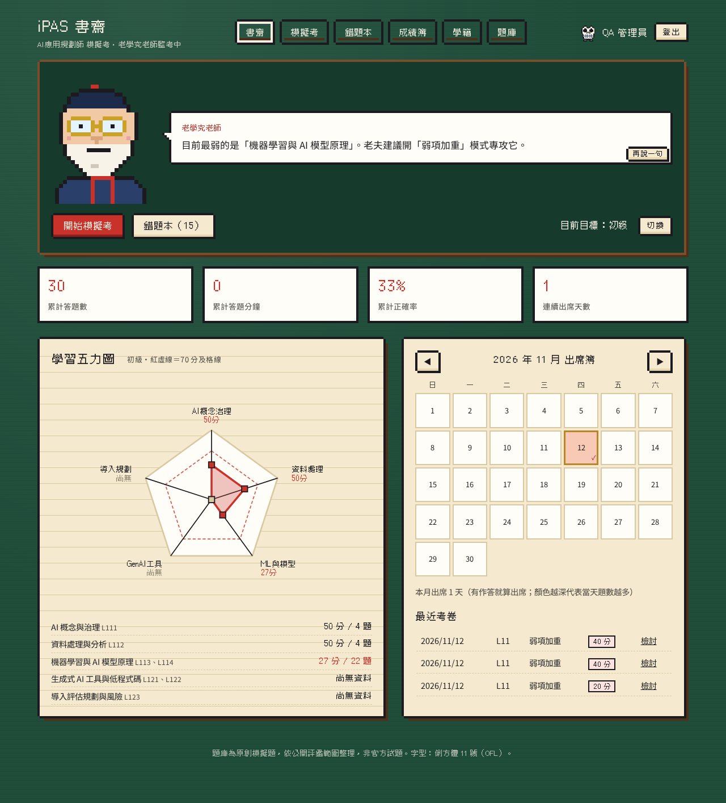
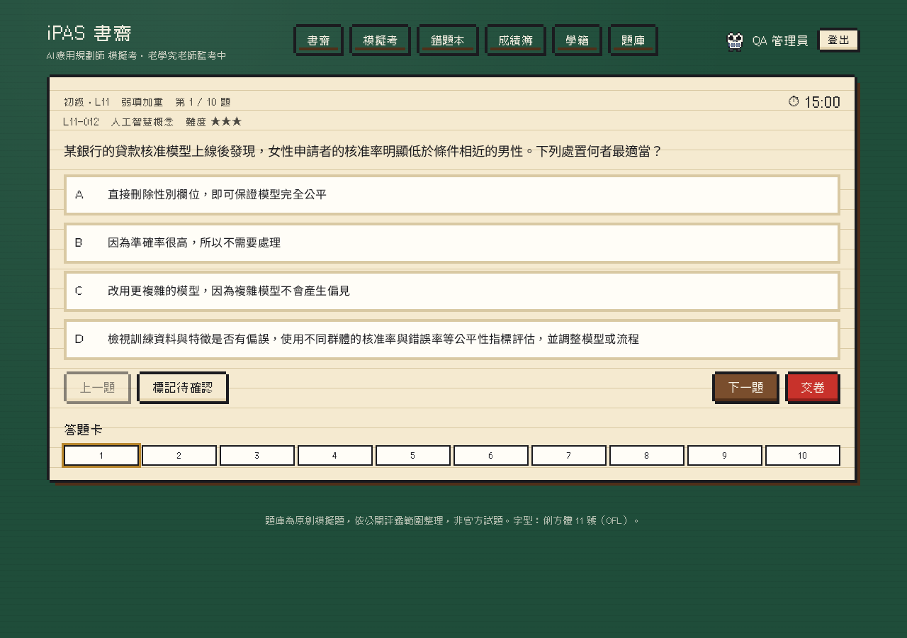
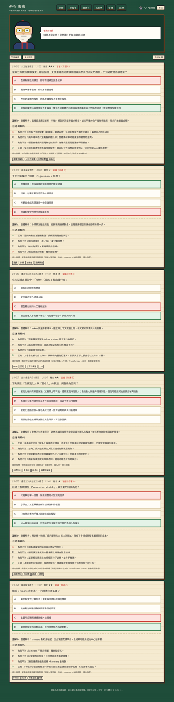

# iPAS 書齋 — AI應用規劃師 模擬考系統

iPAS「AI應用規劃師」（初級／中級）的模擬考練習系統：亂數或**弱項加重**出題、逐選項錯題解析、學習五力圖、出席簿日曆，以及一位會依你的數據說話的 8-bit 老學究老師（MiniMax M2.7）。交卷後還有致敬逆轉裁判的閱卷動畫與紅筆手寫分數。



| 作答 | 閱卷 | 檢討 |
|---|---|---|
|  |  |  |

## 功能

- 身份註冊／登入（Supabase Auth），像素頭像、目標級別
- 題庫 195 題（初級 L11、L12 各 60 題；中級 L21、L22、L23 各 25 題），每題含四個選項的獨立解析
- 出題模式：純亂數、弱項加重（0–100% 拉桿）、只練錯題；依官方節奏計時
- 交卷即批改（伺服器端），答案不外露到前端
- 錯題學習：逐題、逐選項解析，錯題本自動收錄、答對即畢業
- Dashboard：五力圖（各面向正確率）、累計題數／時數／正確率、連續出席天數、月曆出席簿、最近考卷
- 老學究老師：依統計數據即時生成一句話（招呼／盲點提醒／名言），沒有 LLM 金鑰時退回內建語錄
- 管理員題庫匯入頁

## 架構

純前端（HTML/CSS/ES Modules，無建置步驟）＋ Supabase（Postgres + RLS + RPC + Edge Functions）。詳見 [docs/WHITEPAPER.md](docs/WHITEPAPER.md)。

## 快速開始

部署與使用步驟見 [docs/QUICKSTART.md](docs/QUICKSTART.md)。

本機預覽：

```bash
python3 -m http.server 8765
# 開 http://127.0.0.1:8765
```

端對端測試（需 Playwright 與 `.env.local` 的測試帳號）：

```bash
node tests/e2e.mjs
bash tests/api_security.sh
```

## 題庫與考綱

- `data/syllabus.json`：評鑑主題、能力指標、五力圖面向定義
- `data/questions/*.json`：題庫，格式見 `data/QUESTION_SCHEMA.md`
- 題目為依公開評鑑範圍撰寫的原創模擬題，非官方試題

## 安全

- 金鑰（MiniMax）只存在 Supabase Edge Function Secrets，不在程式碼與 repo
- 所有資料表啟用 RLS，寫入走 `security definer` RPC
- `.env*` 已列入 `.gitignore`

## 授權

程式碼 MIT。字型「俐方體 11 號（Cubic 11）」採 SIL OFL 1.1，授權文件見 `assets/fonts/Cubic-11-OFL.txt`。
